  

  
<picture>
    <source media="(prefers-color-scheme: light)" srcset="https://skillicons.dev/icons?i=go,python,js,cs,postgres,redis,docker&amp;theme=light">
    
  </picture>

  
<picture>
    <source media="(prefers-color-scheme: dark)" srcset="https://raw.githubusercontent.com/VoXDoX/VoXDoX/output/pacman-contribution-graph-dark.svg">
    
  </picture>

  
<picture>
    <source media="(prefers-color-scheme: light)" srcset="https://streak-stats.demolab.com/?user=VoXDoX&amp;hide_border=true&amp;background=00000000&amp;stroke=D8DEE4&amp;ring=9A6200&amp;fire=9A6200&amp;currStreakLabel=875500">
    
  </picture>

